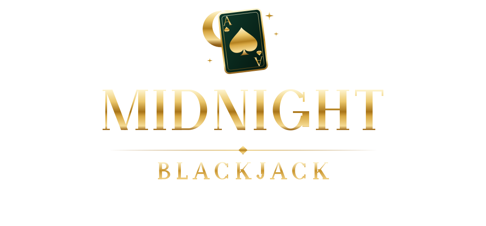
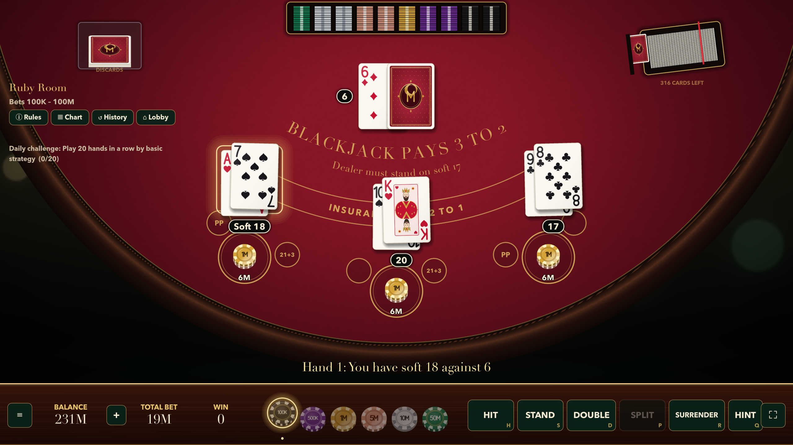
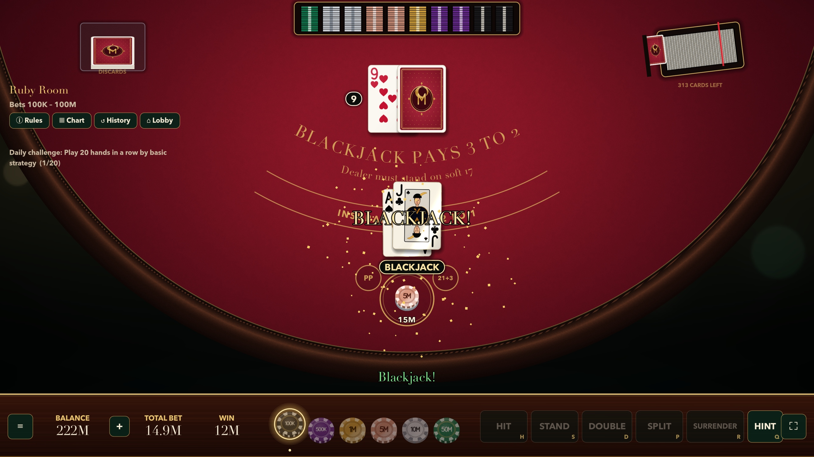
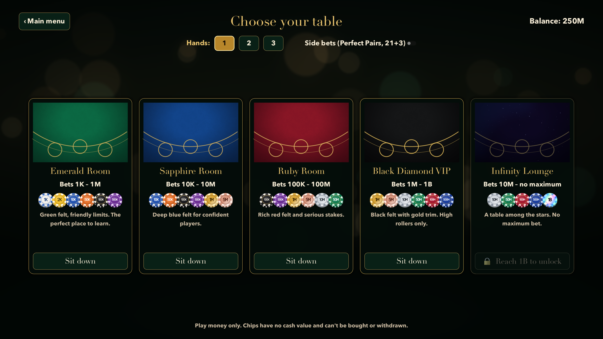
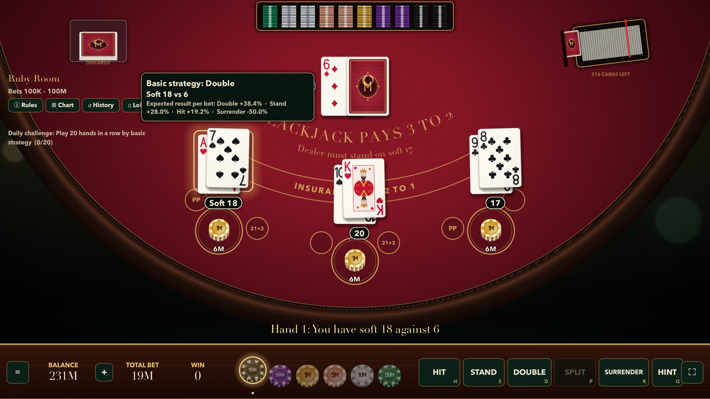

  

<b>An elegant blackjack table for your Mac or PC, with a coach that teaches you to play it perfectly. Play money only.</b>

## ⬇️ Download

[-c9952f?style=for-the-badge&logo=apple)](https://github.com/MilkshakeSR/MidnightBlackjack/releases/latest/download/MidnightBlackjack.dmg)
[-0b6a44?style=for-the-badge&logo=windows)](https://github.com/MilkshakeSR/MidnightBlackjack/releases/latest/download/MidnightBlackjack-Windows.zip)

Or see every version on the [Releases page](https://github.com/MilkshakeSR/MidnightBlackjack/releases).

> **Play money only.** Chips have no cash value and can't be bought or withdrawn. No ads, no purchases, no gambling sites.

## Screenshots

## Features

- **A real blackjack table**: a six-deck shoe with a visible cut card, a discard tray that fills up, the dealer's chip rack, a padded leather rail and gold printing on the felt. Cards arc out of the shoe, the dealer peeks, flips the hole card and draws with a little drama.
- **Every play**: hit, stand, double (including after a split), split up to four hands, late surrender, insurance and even money. Play one, two or three hands at once.
- **Five rooms**: Emerald (1K–1M), Sapphire (10K–10M), Ruby (100K–100M), Black Diamond VIP (1M–1B) and the star-lit Infinity Lounge with no maximum. Thirteen chip designs from 1K to an iridescent 1B diamond chip.
- **Your bankroll**: start with 100K up to 1B, or Unlimited. Top up for free whenever you like.
- **Your rules**: 1–8 decks, dealer hits or stands on soft 17, 3:2 or 6:5, double after split, re-split aces, surrender, the European no-hole-card rule and continuous shuffle, with the house edge for each, measured by playing 10 million simulated hands per rule.
- **Optional side bets**: Perfect Pairs and 21+3.
- **Get better**: a Strategy Coach with hints and gentle mistake warnings, basic-strategy charts generated for your exact rules, accuracy tracking with your most common mistakes, a Hi-Lo card counting trainer with count checks and a speed drill, and a three-hand guided tutorial.
- **Fun extras**: 31 achievements, a win-streak flame, a daily challenge (just a badge, never chips), detailed statistics with a balance chart, and your last 100 hands with step-by-step replays.
- **Fair dealing**: the shoe is shuffled with Fisher–Yates from a cryptographically seeded generator. Its order is fixed when shuffled and never changes based on your bets, balance or decisions.
- **Original everything**: cards, chips, art, sound effects and lounge-jazz music were all made for this game. Optional dealer voice using your computer's voices.
- **Comfortable**: fullscreen on any display from a 13" MacBook Air to ultrawide, keyboard and controller support, larger text, reduce motion, high-contrast cards, a 4-colour deck and colour-blind-friendly results.

## Requirements

- **Mac:** Apple Silicon (M1 or newer), macOS 11 Big Sur or later.
- **Windows:** Windows 10 or 11 (64-bit) with a graphics card that supports Vulkan or DirectX 12.

## Install

**Mac**
1. Open `MidnightBlackjack.dmg`.
2. Drag **MidnightBlackjack** into **Applications**.
3. The first time, right-click it in Applications and choose **Open**, then click **Open** again.
   (The app isn't notarized by Apple, so macOS asks you to confirm once.)

**Windows**
1. Unzip `MidnightBlackjack-Windows.zip` anywhere.
2. Run `MidnightBlackjack.exe`.
3. If SmartScreen warns you, click **More info** → **Run anyway**.

## Updates

Midnight Blackjack checks this page for a new version at most once a day (turn it off in **Settings → Updates**, or press **Check now**). When there's an update, it shows what's new and a **Download update** button, but never in the middle of a hand. Download, then install it the same way as above; your game and settings are kept.

## Privacy

Everything stays on your computer. The only thing that goes online is the optional update check, which asks GitHub for the latest version number. No accounts, analytics or tracking.

## Play responsibly

If gambling ever stops being fun: [gamblinghelponline.org.au](https://www.gamblinghelponline.org.au)

## Report a problem

[Open an issue](https://github.com/MilkshakeSR/MidnightBlackjack/issues/new) and include your version (shown on the start screen and in Settings → Updates).

Version history: [Releases](https://github.com/MilkshakeSR/MidnightBlackjack/releases)

---

© 2026 Steven Robertson. All rights reserved. See [LICENSE.md](LICENSE.md).
